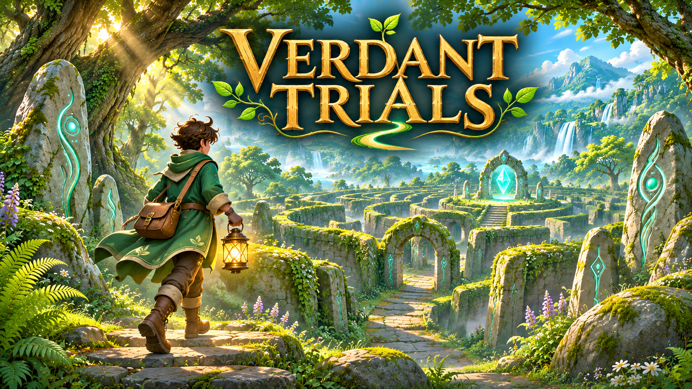
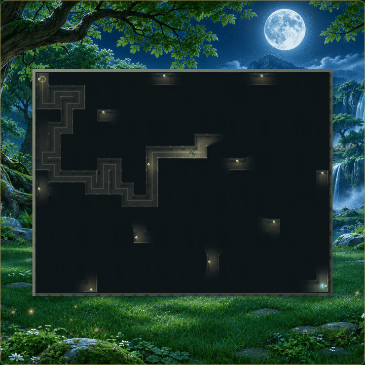
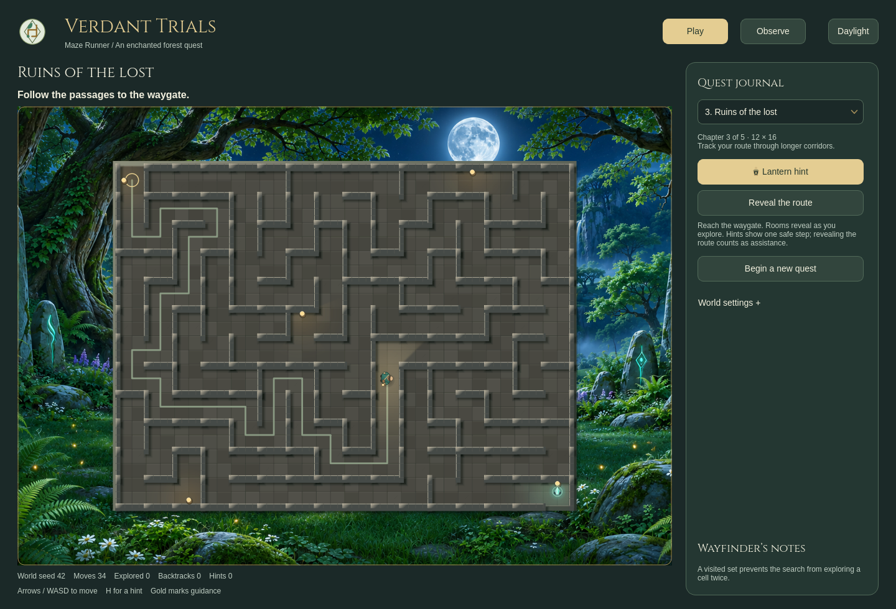
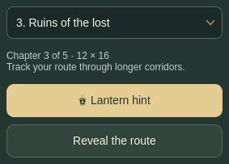
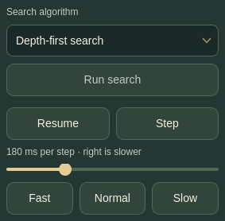
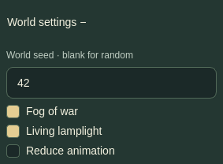
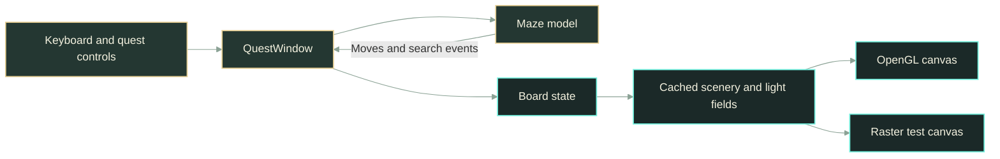

# Verdant Trials — A forest maze adventure

Find your way through stone labyrinths with a lantern, remembered paths, and a glowing waygate. **Verdant Trials** is a desktop maze game with five chapters, paired day-and-night forest scenes, and an Observe mode that makes graph searches visible.

[**Play locally →**](#-quick-start) · [Watch the gameplay](#-features) · [Explore the algorithms](docs/ALGORITHMS.md)

Runs locally without an account or runtime network connection. A graphical desktop is required; progress and preferences last for the current session.

##  Features

- **Explore five chapters.** Start with 20 cells and progress to a 768-cell labyrinth. Every chapter is directly selectable, with optional seeds for replaying a layout.
- **Navigate by lantern light.** A personal lantern follows the adventurer. Fog remembers explored passages; weaker lamps remain visible in the dark, and a teal crystal marks the exit.
- **Walk continuously.** Hold arrows or WASD to move. A quick turn waits for the next corner; releasing the key stops further repeats.
- **Watch a search think.** Compare depth-first and breadth-first search, pause exploration, advance one event, and adjust the pace.
- **Choose the atmosphere.** Daylight and Moonlight use matching forest artwork. Reduced animation provides immediate movement and steady lighting.

<p align="center">
  
</p>

*Harder chapters in motion: Moonlit thicket and The elder labyrinth. This is a scripted-input capture of the actual Qt game, sampled at 20 frames per second for the GIF; it is not a gameplay-performance benchmark.*

##  Installation

Requires **Python 3.10+**, Git, and a graphical desktop. Native rendering uses OpenGL; a software renderer is available when needed. Qt and Pillow are installed in the project environment, and the display font is bundled.

```bash
git clone https://github.com/yaqyn/verdant-trials.git
cd verdant-trials
python3 -m venv .venv
.venv/bin/python -m pip install -r requirements.txt
```

Linux desktop support may also require your distribution's XCB or Wayland libraries and graphics drivers. No Tkinter or system font installation is needed.

<details>
<summary>Windows setup</summary>

After cloning the repository and entering its directory:

```powershell
py -m venv .venv
.venv\Scripts\python.exe -m pip install -r requirements.txt
.venv\Scripts\python.exe main.py
```

</details>

##  Quick start

```bash
./launch --level 1 --seed 42
```

The forest opens on **The moss gate**. Let the maze form, or choose **Enter maze now** to skip generation. Click the maze, then use arrows or WASD to reach the teal waygate. Close the window to stop the game and its background work.

To begin with a larger chapter:

```bash
./launch --level 4 --seed 42 --delay 180
```

`launch` also works when invoked from another directory.

##  Usage



*The complete interface, showing Ruins of the lost in Moonlight. Fog is disabled in this overview so the entire floor plan can be seen; it is enabled by default in Play.*

### Play the labyrinth



Choose any chapter from the **Quest journal**. The adventurer marks your position; the ring marks the entrance. Explore toward the teal crystal beacon.

| Control | Result |
| --- | --- |
| Arrows / WASD | Move while the maze has focus; hold to keep walking |
| H / Lantern hint | Show one safe step from your current position |
| Reveal the route | Show the remaining path to the exit |
| Begin a new quest | Generate another layout, using the seed setting |

Hints and route reveals count as assistance. A completed quest reports moves, direct-route length and assistance, then offers the next chapter. Chapter size increases, but route length and branching also depend on the seed.

### Observe the algorithms



Switch to **Observe**, choose DFS or BFS, then **Run search**. Gold shows the current route, blue marks explored cells, and ash marks backtracking. Wayfinder notes explain the current action.

- **Pause / Resume** freezes or continues exploration. Space does the same while the maze is focused.
- **Step** advances one event without resuming the timer.
- **Fast, Normal, Slow** and the slider change the delay while a search is running. Backtracking holds slightly longer.

Observe exposes the full map. Replay the same maze with the other algorithm to compare exploration order. [The algorithm guide](docs/ALGORITHMS.md) explains generation, DFS, BFS and their tradeoffs.

##  Configuration



Open **World settings** in the quest journal:

| Setting | Behavior |
| --- | --- |
| World seed | Blank creates a random layout; a number reproduces a layout at the same chapter |
| Fog of war | Hides unexplored passages in Play; explored areas remain dimly visible |
| Living lamplight | Enables gentle ambient light movement; turn it off for steady illumination |
| Reduce animation | Makes movement immediate and removes light fades and movement |
| Daylight / Moonlight | Switches the interface and forest image without resetting the quest |

Wallpaper fills its viewport through proportional cropping, while maze cells remain square. Preferences and progress are not written to disk. Invalid seed input preserves the current maze and shows inline feedback.

Command-line options are `--level 1..5`, optional `--seed`, and `--delay 30..600` milliseconds per generation/search event. The default search pace is **180 ms**; it is separate from walking speed.

If a desktop cannot create an OpenGL context, select software rendering:

```bash
MAZE_RENDERER=raster ./launch
```

The raster path preserves the scene but can be slower at large window sizes. Headless verification uses `QT_QPA_PLATFORM=offscreen` instead of opening a desktop window.

##  Architecture

The maze model owns connectivity and movement. The quest window owns game state and controls. Rendering consumes that state through a hardware-accelerated board, with the same painter available for headless tests.



Visibility rays walk the cells they cross. Nearby lighting fields are cached and blended during movement; a single background worker prepares upcoming image data. Fog memory and texture uploads update affected areas, and static scenery, fixtures and character poses are reused. This is wall-aware **2D lighting**, rather than a physically based global-illumination simulation.

| Source | Responsibility |
| --- | --- |
| [maze.py](maze.py) | Cells, generation, graph searches, movement and route hints |
| [qt_app.py](qt_app.py) | Quest state, native controls, shortcuts and search timer |
| [qt_board.py](qt_board.py) | Scene layers, fog, light caches and smooth movement |
| [lighting.py](lighting.py) | Grid visibility and deterministic lamp placement |
| [light_field.py](light_field.py) | Worker-safe image preparation and gradient feathering |
| [levels.py](levels.py) | Chapter sizes, names and learning concepts |
| [DESIGN.md](DESIGN.md) | Visual direction and interaction contracts |

##  Verification

```bash
QT_QPA_PLATFORM=offscreen .venv/bin/python -m unittest discover -v
```

Tests cover graph invariants, deterministic generation, large levels, BFS routes, wall occlusion, worker image ownership, keyboard movement, continuous turns, timer cancellation, themes, hints and fog behavior. GitHub Actions runs the suite on Python 3.11–3.13.

To measure actual traversal, including new-cell discovery and turns:

```bash
.venv/bin/python benchmark_scene.py --level 5 --fullscreen
```

The report includes paint times, frame gaps, CPU use, renderer, viewport changes and OpenGL swap-event cadence. A 16.7 ms render budget targets 60 fps; timing depends on hardware, pixel density, viewport size and other desktop activity. Paint and swap events do not measure physical monitor scanout. The README GIF is a visual demonstration, not evidence of frame rate.

[Media capture instructions and provenance](docs/MEDIA.md) describe how the screenshots and scripted GIF were made.

##  Limitations

- Progress and preferences are session-only. All chapters are available without unlocking them.
- The game requires a desktop; there is no browser, mobile or packaged binary release.
- Native Qt controls provide keyboard focus and accessible names, but no platform-wide assistive-technology certification is claimed.
- Small lanterns intentionally remain visible through unexplored fog; discovering the intervening passages still requires exploration.

For a reproducible problem, [open an issue](https://github.com/yaqyn/verdant-trials/issues) with the chapter, seed, operating system and renderer.

##  Artwork and acknowledgments

The forest illustrations, character rendering and cover belong to this project's visual identity. The cover is illustrative key art; the screenshots and GIF show the running game. [Media provenance](docs/MEDIA.md), [day artwork](assets/VERDANT-WORLD.md) and [night artwork](assets/VERDANT-NIGHT.md) document their sources and prompts.

No repository-wide license is declared. The bundled Cinzel typeface retains its [SIL Open Font License](assets/fonts/OFL-Cinzel.txt) and [source notes](assets/fonts/SOURCES.md).

> **Learning Journey Project · Boot.dev.** Based on [Build a Maze Solver in Python](https://www.boot.dev/courses/build-maze-solver-python), extended from the course's Tkinter approach into a Qt forest adventure with progressive chapters, interactive play and search comparison.
