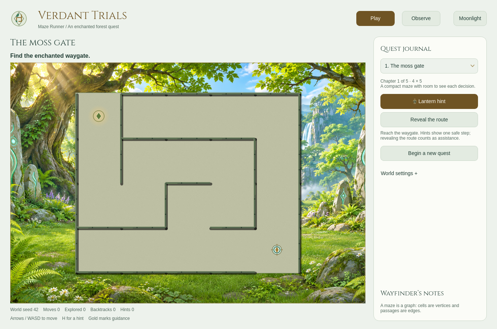

# Maze Runner

**Verdant Trials** is an enchanted-forest RPG quest for playing mazes and watching graph searches find their way. Explore ancient passages, ask the lantern for guidance, or pause an algorithm at its next decision.

> Based on [Boot.dev's Build a Maze Solver in Python](https://www.boot.dev/courses/build-maze-solver-python), extended into a Qt desktop game with progressive chapters and algorithm comparison. The original course uses Tkinter; this interface uses PySide6.



## Launch

Requires **Python 3.10+** and a graphical desktop. Qt is installed in the project environment; no Tkinter or system font installation is needed.

```bash
python3 -m venv .venv
.venv/bin/python -m pip install -r requirements.txt
./launch
```

On Windows, use `.venv\Scripts\python.exe main.py` after installing requirements with that interpreter.

```bash
./launch --level 3 --seed 42 --delay 180
```

`launch` works from another directory. The game needs no account or runtime network connection. Qt's Linux desktop platform may require distribution-provided XCB or Wayland libraries. On a headless machine, use the offscreen platform for tests rather than launching a visible window.

## Play

Click the maze, then move with **arrows or WASD**. Reach the gate to finish the chapter. A cloaked explorer marks your position; a ring marks the start. **H** requests a lantern hint. Reveal the route shows the remaining path. Both count as assistance.

Fog of war hides unexplored corridors in Play. The soft lantern footprint becomes known; previously explored passages stay dimly visible, and distant walls remain fully hidden. Hints and revealed routes remain usable. Observe shows the full floor plan for teaching. World settings can disable fog or lamp movement, and Reduce animation removes the fades and movement interpolation.

A completed quest shows your move count, the direct route length and assistance used, then offers the next chapter. All five chapters are available from the quest selector. Chapter size increases from 20 to 768 cells; seeds vary in route length and branching, so a larger board is not guaranteed to be harder in every instance.

## Observe

Switch to **Observe** to expose the algorithm tools. Choose DFS or BFS and Run search. Pause freezes exploration; Step advances one event. Space toggles pause while the maze is focused. Gold shows the current route, blue marks explored cells, and ash marks backtracking. Wayfinder notes explain each action.

The default delay is **180 ms per event**. Fast (60 ms), Normal (180 ms), Slow (400 ms), and the live 30–600 ms slider change the pace. Backtracking holds slightly longer. **Enter maze now** skips generation when you want to start playing immediately. Search can be replayed on the same board with another algorithm.

## World settings

The quest panel's World settings disclosure contains an optional numeric seed and reduced movement animation. Blank seeds create random layouts; numeric seeds reproduce the same layout at a given chapter. The actual world seed appears below the maze. Invalid input preserves the current quest.

Daylight is the default: a bright enchanted woodland with waterfalls and runic stones. Moonlight uses a night version of that same scene, with a luminous moon and warm distant valley lights. Wallpaper always keeps its proportions when resizing: it fills the viewport through centered cropping, while the maze keeps square cells independently. Lighting changes preserve your current quest and animation state. Progress and preferences are not saved between sessions.

## Artwork and rendering

The board uses paired original day/night forest artwork and a top-down castle cutaway: stone-tiled ground, raised masonry, wall shadows, and an explorer inside the corridors. Lamps gently fade in after generation. Their radial light pools are clipped by wall visibility, so illumination stops at solid walls. A small amount of slow flicker makes the light feel alive without flashing. Qt paints at display resolution and animates player movement. Cinzel is bundled for quest headings under its SIL Open Font License; body copy uses a readable sans face.

[Day wallpaper provenance and generation prompt](assets/VERDANT-WORLD.md), [night edit prompt](assets/VERDANT-NIGHT.md) document the original image and font sources. No existing game's artwork is included.

## Learn the algorithms

Generation carves a connected tree with exactly one route between any pair of cells. DFS follows a branch and backs out of dead ends. BFS explores by distance. Both find the same route in these tree mazes, but their exploration order and visit counts differ.

Explicit stacks preserve DFS behavior without Python's recursion-depth limit. Qt advances the generators with a cancellable timer, keeping user input separate from traversal logic. Animation time is a teaching control, not an algorithm benchmark.

Read [the algorithm walkthrough](docs/ALGORITHMS.md) for mechanics, complexity and short experiments.

## Verify

```bash
QT_QPA_PLATFORM=offscreen .venv/bin/python -m unittest discover -v
.venv/bin/python -m compileall -q main.py maze.py levels.py qt_app.py qt_board.py
```

To measure animated rendering on the largest chapter:

```bash
QT_QPA_PLATFORM=offscreen .venv/bin/python benchmark_scene.py --level 5
```

Omit `QT_QPA_PLATFORM=offscreen` to measure the native desktop window. The report includes paint times, the share within the 16.7 ms budget, Qt paint-event cadence and process CPU use. It measures Qt rendering rather than display presentation; results depend on window size, pixel density and hardware. Static scenery, lamps, character poses and fog memory are cached; movement updates the local light footprint.

Tests protect graph invariants, deterministic seeds, large levels, BFS shortest routes, movement, quest completion, hints, input validation, timer cancellation, themes and board rendering. Qt workflow tests need the installed requirements; they can run without a desktop using the offscreen platform. CI runs Python 3.11–3.13. A CI configuration is included; local verification does not imply a remote CI run.

| File | Responsibility |
| --- | --- |
| `maze.py` | Cells, generation, searches, movement and route hints |
| `levels.py` | Chapters, grid dimensions and learning concepts |
| `qt_app.py` | Quest workflows, shared styles, controls and timer |
| `qt_board.py` | Castle cutaway, lights, fog, scenery and player animation |
| `lighting.py` | Wall visibility and deterministic lamp placement |
| `assets/` | Original illustration, vector art and licensed font |
| `main.py`, `launch` | Desktop entry point and location-independent launcher |

[DESIGN.md](DESIGN.md) records visual and interaction decisions. Native Qt controls provide keyboard navigation and focus. Reduced motion disables movement interpolation. Assistive-technology behavior varies by platform; no accessibility certification is claimed.
